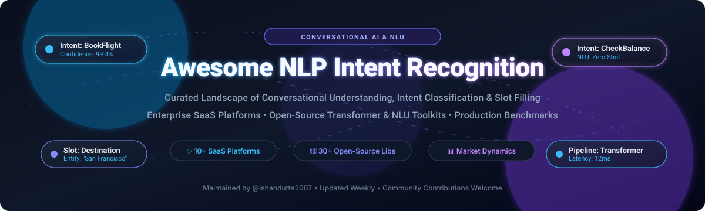
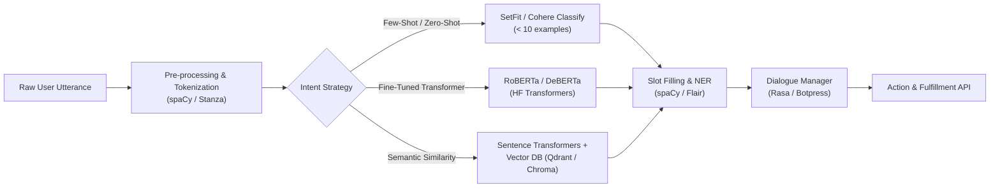

# 🎯 Awesome NLP Intent Recognition & Classification

  <strong>A curated directory of enterprise SaaS solutions, leading open-source models, and developer toolkits for Natural Language Understanding (NLU), Intent Recognition, and Slot Filling.</strong>

  
  
  
  
  
  

---

## 📌 Table of Contents

- [💡 Overview](#-overview)
- [📊 Sector Overview & Market Dynamics](#-sector-overview--market-dynamics)
- [🏢 Enterprise SaaS & Hosted Platforms](#-enterprise-saas--hosted-platforms)
- [💻 Open-Source GitHub Projects](#-open-source-github-projects)
- [🛠️ Architecture & Recommended Tech Stack](#️-architecture--recommended-tech-stack)
- [🤝 How to Contribute](#-how-to-contribute)
- [⭐ Star History](#-star-history)
- [💖 Support & Sponsorship](#-support--sponsorship)
- [⚖️ Disclaimer & Compliance](#️-disclaimer--compliance)

---

## 💡 Overview

Intent recognition is a cornerstone discipline in **Conversational AI** and **Natural Language Understanding (NLU)**. Given raw user utterances, intent detection classifies the speaker's overarching goal (e.g., `BookFlight`, `CheckBalance`, `EscalateToAgent`), while slot filling and Named Entity Recognition (NER) extract critical parameters (e.g., dates, locations, account numbers).

This repository serves as a production-grade directory and decision-making resource for:
- 🤖 **Chatbot & Virtual Assistant Engineers** designing dialogue systems and customer experience pipelines.
- 🔬 **NLP Researchers & Data Scientists** exploring state-of-the-art transformer embeddings, few-shot learners, and weak supervision.
- 💼 **Enterprise Architects & Product Leaders** benchmarking proprietary cloud APIs against data-sovereign self-hosted stacks.

---

## 📊 Sector Overview & Market Dynamics

The global conversational AI and NLP market is projected to reach approximately **$30 billion to $49 billion by 2026–2030**, expanding at a robust compound annual growth rate (**CAGR of ~23%–28%**).

The intent recognition and conversational understanding landscape is **moderately fragmented**: hyper-scale cloud incumbents (Microsoft Azure, Google Cloud, AWS, Salesforce, and IBM) anchor large enterprise voice and multi-channel deployments with integrated cloud ecosystems, while a dynamic tier of specialized frontier model providers (Cohere, OpenAI, Anthropic) and domain-specific open-core frameworks (Rasa, Botpress, Snips) capture significant market share in developer agility, on-premise governance, and specialized few-shot workflows.

---

## 🏢 Enterprise SaaS & Hosted Platforms

The following table summarizes enterprise SaaS and managed cloud APIs for intent recognition and conversational language understanding, ranked in descending order by **parent company market capitalization / corporate valuation**.

| Platform | Company Valuation / Revenue Tier | Pricing (Starting Tier) | Free Tier Limits / Trial | Core Capabilities & Focus |
| :--- | :--- | :--- | :--- | :--- |
| **[Azure Conversational Language Understanding](https://azure.microsoft.com/en-us/products/ai-services/conversational-language-understanding)** 🌐 | **~$3.1T Market Cap** (Microsoft) | **$1.50 per 1,000 text records** (Standard S tier) | **5,000 text records / month** (Free F0 tier) | Native Azure AI service offering joint intent classification and entity extraction with multilingual support. |
| **[AWS Lex](https://aws.amazon.com/lex/)** ☁️ | **~$2.0T Market Cap** (Amazon) | **$0.004 per text request** (~$4.00 per 1,000 text requests) | **10,000 text requests / month** free for the first 12 months (AWS Free Tier) | Fully managed AWS conversational AI engine for automated bots with intent matching, slot filling, and voice integration. |
| **[Google Cloud Dialogflow](https://cloud.google.com/dialogflow)** 🔍 | **~$2.0T Market Cap** (Alphabet) | **$0.007 per text request** (Dialogflow CX: $7.00 per 1,000 requests; ES: $0.002/request) | **$600 free credit** for new Dialogflow trial (plus Google Cloud $300 90-day trial) | Comprehensive omnichannel conversational AI platform supporting visual flow builders, intent detection, and hybrid search. |
| **[Wit.ai](https://wit.ai/)** 👥 | **~$1.4T Market Cap** (Meta) | **$0.00 (100% Free Service)** | **Free forever with rate limit of 250 requests / minute** | Meta-backed developer platform providing turnkey natural language processing, intent detection, and slot parsing. |
| **[Salesforce Einstein Intent API](https://www.salesforce.com/products/einstein/)** ⚡ | **~$280B Market Cap** (Salesforce) | **$25 per user/month** (Salesforce Starter suite) up to **$50/conversation** (Einstein 1 Service edition) | **30-day full feature free trial** with access to Einstein platform sandbox | Deeply embedded enterprise CRM intent classification for automated ticket routing, customer case categorization, and service bots. |
| **[IBM Watson Assistant](https://www.ibm.com/products/watson-assistant)** 💼 | **~$210B Market Cap** (IBM) | **$140 / month** (Plus plan includes up to 1,000 Monthly Active Users; $14 per additional 100 MAU) | **Lite Plan: Free forever** up to **1,000 Monthly Active Users (MAU)** and 10,000 messages / month | Battle-tested enterprise virtual agent ecosystem with native intent recognition, disambiguation, and legacy system connectors. |
| **[Cohere Classify](https://cohere.com/classify)** 🚀 | **~$5.5B Valuation** ($50M+ ARR) | **$0.0001 per classification query** ($0.10 per 1,000 queries on Production API) | **Trial Key: Free forever** with **100 API calls / minute** for non-commercial prototyping | Frontier LLM few-shot text classifier ideal for rapid intent classification with fewer than 5 labeled training examples per intent. |
| **[Hugging Face Inference](https://huggingface.co/inference-api)** 🤗 | **~$4.5B Valuation** ($70M+ ARR) | **$0.00006 per second** of serverless compute (~$9/month Pro subscription for elevated limits) | **Free forever tier** with rate-limited shared serverless inference endpoints | Hosted access to thousands of open-source fine-tuned intent models and zero-shot NLU pipelines. |
| **[Rasa](https://rasa.com/)** 🤖 | **~$200M Valuation** (Series C funded) | **$35,000 / year** enterprise starting tier for Rasa Pro & Enterprise Platform | **Free 30-day enterprise evaluation license**; Rasa Open Source engine is 100% free forever | Premier open-core conversational AI platform designed for mission-critical enterprise deployments requiring data privacy. |
| **[OneAI](https://www.oneai.com/)** 🧠 | **~$25M Valuation** (Seed / Series A funded) | **$0.0015 per word processed** on standard pay-as-you-go | **Free tier of $10 monthly API credits** (~100,000 words / month forever) | Composable language AI API chain delivering intent extraction, sentiment analysis, and topic tagging in a unified payload. |

---

## 💻 Open-Source GitHub Projects

The following table presents open-source repositories, libraries, and frameworks for intent classification, NLU pipelines, and conversational AI. Sorted in descending order by **GitHub Stars_Count** 🌟.

| Repository | GitHub_Stars | License | Primary Use Case & Key Focus |
| :--- | :--- | :--- | :--- |
| **[Hugging Face Transformers](https://github.com/huggingface/transformers)** 🚀 |  | Apache 2.0 | SOTA transformer architectures (BERT, RoBERTa, DeBERTa) for fine-tuning text classification, zero-shot intent recognition, and sequence labeling. |
| **[google-research/bert](https://github.com/google-research/bert)** 🧠 |  | Apache 2.0 | Foundational bidirectional encoder representations for language; benchmark baseline for intent classification and slot filling tasks. |
| **[OpenAI CLIP](https://github.com/openai/CLIP)** 🖼️ |  | MIT | Multimodal zero-shot classifier capable of mapping user utterances and images directly to intent concepts without task-specific training data. |
| **[spaCy](https://github.com/explosion/spaCy)** ⚡ |  | MIT | Production-grade industrial NLP library with fast TextCategorizer components, EntityRecognizer, and streamlined rule-plus-statistical pipelines. |
| **[fairseq](https://github.com/facebookresearch/fairseq)** 🔬 |  | MIT | Meta AI sequence modeling toolkit for pretraining masked language models and custom sequence classification models. |
| **[Label Studio](https://github.com/HumanSignal/label-studio)** 🏷️ |  | Apache 2.0 | Multi-modal data annotation tool for labeling user intents, bounding slot entities, and training active-learning classifiers. |
| **[fastText](https://github.com/facebookresearch/fastText)** 🏎️ |  | MIT | Ultra-fast subword text representation and classification library capable of scoring thousands of intent queries per second on CPU. |
| **[Rasa Open Source](https://github.com/RasaHQ/rasa)** 🛡️ |  | Apache 2.0 | The industry standard open-source framework for contextual conversational AI, custom DIETClassifier NLU pipelines, and dialogue handling. |
| **[Sentence Transformers](https://github.com/UKPLab/sentence-transformers)** 📐 |  | Apache 2.0 | Compute dense semantic embeddings for utterances to perform vector-similarity intent matching and clustering via vector search engines. |
| **[NVIDIA NeMo](https://github.com/NVIDIA/NeMo)** 🎙️ |  | Apache 2.0 | Conversational AI toolkit featuring GPU-accelerated models for joint Intent Detection and Slot Filling (Joint IDS) in spoken dialogue systems. |
| **[Gensim](https://github.com/piskvorky/gensim)** 📚 |  | LGPL-2.1 | Unsupervised semantic topic modeling and document indexing library used for intent discovery and clustering unannotated customer conversations. |
| **[Botpress](https://github.com/botpress/botpress)** 🤖 |  | AGPL-3.0 | Full-stack conversational platform featuring a built-in NLU intent engine, visual conversation flow builder, and omnichannel adapters. |
| **[NLTK](https://github.com/nltk/nltk)** 📖 |  | Apache 2.0 | Comprehensive Python toolkit for natural language processing, tokenization, rule-based heuristics, and classical Naive Bayes intent classifiers. |
| **[ChatterBot](https://github.com/gunthercox/ChatterBot)** 💬 |  | BSD-3-Clause | Machine-learning-based dialogue engine capable of intent matching and generating conversational automated responses. |
| **[Flair](https://github.com/flairNLP/flair)** 🌸 |  | MIT | SOTA NLP framework integrating stacked embeddings, document classification for intent tagging, and high-accuracy NER for slot extraction. |
| **[PaddleNLP](https://github.com/PaddlePaddle/PaddleNLP)** 🏓 |  | Apache 2.0 | Rich NLP model zoo built on PaddlePaddle offering ready-to-run Taskflow APIs for intent recognition, relation extraction, and Chinese/multilingual NLU. |
| **[AllenNLP](https://github.com/allenai/allennlp)** 🔬 |  | Apache 2.0 | PyTorch-based NLP research platform designed for building, evaluating, and visualizing cutting-edge semantic parsing and classification models. |
| **[ParlAI](https://github.com/facebookresearch/ParlAI)** 🗣️ |  | MIT | Meta AI platform for training and benchmarking dialogue agents, evaluating intent understanding across standard conversational benchmarks. |
| **[CoreNLP](https://github.com/stanfordnlp/CoreNLP)** 🏛️ |  | GPL-3.0 | Stanford's robust Java NLP toolkit providing linguistic analysis, sentiment classification, entity extraction, and intent feature engineering. |
| **[TextBlob](https://github.com/sloria/TextBlob)** 📝 |  | MIT | Clean, beginner-friendly Python library for basic NLP tasks, text classification, and rapid prototype intent parsing. |
| **[Stanza](https://github.com/stanfordnlp/stanza)** 🌲 |  | Apache 2.0 | Stanford NLP official Python package with accurate multi-lingual pipeline components for tokenization, lemmatization, and NER. |
| **[DeepPavlov](https://github.com/deeppavlov/DeepPavlov)** 🏰 |  | Apache 2.0 | Deep learning framework tailored for conversational AI, multi-intent classification, slot filling, and goal-oriented dialog systems. |
| **[Snorkel](https://github.com/snorkel-team/snorkel)** 🤿 |  | Apache 2.0 | Programmatic data labeling framework to bootstrap intent classification training sets quickly without manual manual sample curation. |
| **[Argilla](https://github.com/argilla-io/argilla)** 🦔 |  | Apache 2.0 | Open-source data-centric platform for tracking, curating, and validating intent classification data for small models and LLMs. |
| **[Spark NLP](https://github.com/JohnSnowLabs/spark-nlp)** ⚡ |  | Apache 2.0 | High-performance distributed NLP library for Apache Spark offering healthcare and enterprise-grade intent classification at petabyte scale. |
| **[Snips NLU](https://github.com/snipsco/snips-nlu)** 📱 |  | Apache 2.0 | Lightweight, on-device Python/Rust NLU engine tailored for offline embedded devices, privacy-first assistants, and deterministic intent parsing. |
| **[SetFit](https://github.com/huggingface/setfit)** 🎯 |  | Apache 2.0 | Efficient few-shot classification using Sentence Transformers; achieves remarkable intent recognition accuracy with as few as 8 samples per intent. |
| **[Apache OpenNLP](https://github.com/apache/opennlp)** 🪶 |  | Apache 2.0 | Machine learning toolkit for Java handling maximum entropy and perceptron-based document classification and intent parsing. |
| **[Mallet](https://github.com/mimno/Mallet)** 🔨 |  | Common Public License | Java-based package for statistical natural language processing, document classification, clustering, and topic models. |
| **[MindNLP](https://github.com/mindspore-lab/mindnlp)** 🧠 |  | Apache 2.0 | Deep learning NLP library based on the MindSpore framework supporting end-to-end intent detection and transformer pipelines. |

---

## 🛠️ Architecture & Recommended Tech Stack

When constructing a custom self-hosted intent recognition system, consider pairing these modular layers:

---

## 🤝 How to Contribute

Contributions are enthusiastically welcomed! To propose additions, updates, or benchmarks:

1. **Fork the Repository** on GitHub.
2. **Add or Edit Entries** in [README.md](file:///C:/Users/hp/Documents/Projects/Awesome-NLP-Intent-Recognition/README.md). Keep descriptions factual, and include exact pricing/limits for SaaS or repository metrics for open-source.
3. **Verify Badges & Links**: Ensure star links point to the project's `/stargazers` page.
4. **Submit a Pull Request** with a descriptive summary of your changes.

---

##  Star History

---

## 💖 Support & Sponsorship

Thank you for exploring and utilizing **Awesome NLP Intent Recognition**! 🌟

If this repository has helped your research, team, or production conversational AI architecture, please consider supporting the project:
- ⭐ **Star this repository** to help others discover it across GitHub.
- 🍴 **Fork and contribute** your favorite models, tools, or real-world benchmarks.
- 📢 **Share with colleagues & friends** working across NLP and conversational AI communities.
- ☕ **Buy a Coffee / Sponsor**: Support ongoing maintenance and curation on the [Sponsor Dashboard](https://github.com/sponsors/ishandutta2007).

Your support keeps this curated ecosystem up-to-date and accessible to all developers! ✨

---

## ⚖️ Disclaimer & Compliance

- This repository is an independently curated educational and technical index. Product names, logos, and brands are property of their respective owners.
- Production implementations of intent recognition and voice transcription systems must comply with data residency standards (**GDPR, CCPA, HIPAA, ISO 27001**) and AI transparency principles.
- Pricing and quotas reflect publicly published documentation and may change over time; refer to each vendor's official pricing page for real-time terms.

---

  Maintained with ❤️ by <a href="https://github.com/ishandutta2007">@ishandutta2007</a> and the Conversational AI community.

